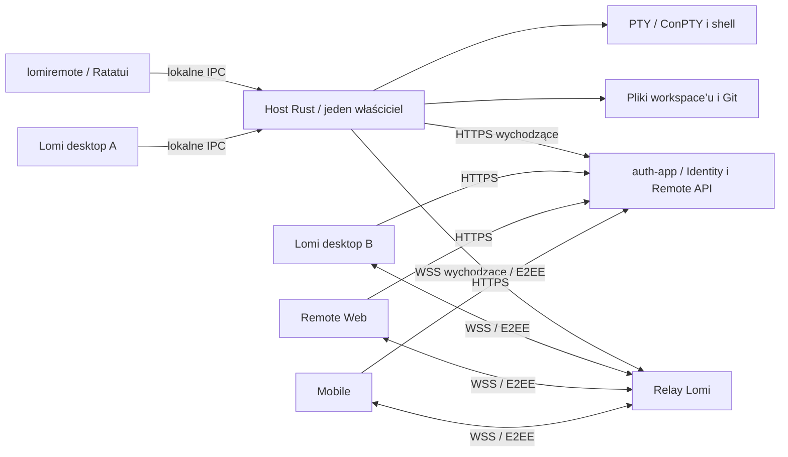

# 02 — Architektura, domena i stack

## Podział systemu



**Control plane**: centralne konta, autoryzacje instalacji, katalog hostów, zgody i granty, online status, relay tickets, odwołanie dostępu. **Data plane**: szyfrowane terminale, metadane, pliki, Git i komendy workspace’u bezpośrednio między klientem a hostem, transportowane przez relay.

Cloud nie wykonuje `git`, nie otwiera plików hosta i nie uruchamia shelli. Udostępnienie workspace’u nie jest synchronizacją jego katalogu do chmury. Host działa za NAT; v1 nie wymaga portów przychodzących.

## Jedna implementacja hosta i dwa interfejsy lokalne

Jedno wydanie zawiera `lomiremote` z trybami TUI/CLI/daemon/service. OS service uruchamia dokładnie tryb daemon; nigdy TUI. Kod wejścia usługi Windows jest cienkim adapterem do tego samego rdzenia.

Host jest osobnym procesem także przy instalacji razem z desktopem. Desktop korzysta z IPC zamiast uruchamiać alternatywny host w Tauri. Wszystkie zwykłe terminale, które mogą być później udostępnione, od początku tworzy host. Nie próbujemy przenosić żywego PTY z działającego Tauri do innego procesu po kliknięciu Share.

Oprócz blokady lokalnej backend przyznaje jednej działającej instancji hosta `runtime_id` i monotoniczną `runtime_generation` z krótkim lease. Dotyczy to trwałego host ID i jest osobne od lease właściciela relay. Sklonowany profil lub nakładający się start nie może publikować równolegle: drugi runtime otrzymuje `HOST_BUSY` do wygaśnięcia właściciela albo świadomego revoke/takeover. Każdy nowy właściciel podnosi access epoch i ponownie uzgadnia grants/session epochs. Local-only praca bez lease jest możliwa, ale nie remote execution.

Jeden właściciel na `(profil OS, data_dir)`, zabezpieczony blokadą utrzymywaną przez cały czas życia, zweryfikowaną ścieżką IPC i endpointem discovery. Nie wystarcza test istnienia pliku socket ani PID. Desktop i CLI używają tego samego domyślnego `data_dir`, host ID i instalacji. Inny profil jest świadomą osobną instancją i nie może wskazywać tych samych baz/PTY.

Discovery zwraca także build ID, IPC major/minor i capabilities. Desktopowy instalator może dostarczać ten sam podpisany pakiet hosta, ale nie instaluje konkurencyjnej prywatnej kopii uruchamianej bezpośrednio z zasobów Tauri. Jeden rejestr instalacji wskazuje aktywną wersję. Przy zgodnym IPC klient używa istniejącego hosta; przy niezgodnym pokazuje potrzebną aktualizację i liczbę aktywnych sesji. Nie restartuje ich automatycznie tylko dlatego, że zaktualizowano GUI. Compatibility window lokalnego IPC jest osobną decyzją od świadomego braku kompatybilności starego Remote.

Usługa uruchamiana przed logowaniem może pracować jako dedykowany użytkownik. Taki profil nie jest automatycznie profilem zwykłego desktopu. Współdzielenie jednego hosta z desktopem wymaga zgodnej tożsamości OS i ACL; nie łączymy dwóch kont przez poluzowanie IPC.

## Własność danych

| Dane | Jedyny autorytet | Trwałość / sposób użycia |
| --- | --- | --- |
| Użytkownik i host authorization | Identity / PostgreSQL | Odnawianie i odwoływanie poświadczeń |
| Klucz hosta | Lokalny secret store | Nie trafia do chmury ani klienta |
| Workspace ID, nazwa, root, shell profiles | Host / SQLite | Wspólne dla TUI i desktopu |
| Udostępnianie, capabilities, epochs | Host + bieżąca autoryzacja cloud | Zgoda lokalna trwała; granty czasowe |
| Karty terminalowe, terminalowe splity, sesje | Host | Zmiany przez komendy, nie zapisy snapshotu klienta |
| Właściciel PTY i jego stan wykonania | Host / pamięć procesu | Żyje przy zamknięciu GUI; kończy się przy restarcie właściciela |
| Stan emulatora i bounded scrollback | Rust terminal engine / RAM | Snapshot + delta; bez trwałego nagrywania domyślnie |
| Zawartość plików i Git | Dysk hosta | Cloud przechowuje tylko routing/autoryzację |
| Otwarte okna, aktywna karta, zoom i scroll klienta | Dany klient | Zamykanie okna nie zamyka wspólnego terminala |
| Niezapisane bufory, lokalne browser/Android/chat views | Właściwa aplikacja lokalna | Nie publikujemy do Remote v1 |
| Wyniki i receipts operacji | Host / SQLite + aktualny stan wykonawcy | Ograniczony okres retry, jawne outcome unknown |

### Model projektu i workspace’u

Zachowujemy pojęcia Lomi: `Project` wskazuje katalog, a jeden projekt może mieć wiele nazwanych `Workspace`. Onboarding nazwa + lokalizacja tworzy projekt i pierwszy workspace lub używa już zarejestrowanego projektu. Katalog istnieje na hoście A; komputer B nie interpretuje go jako własnej ścieżki.

`Workspace` ma trwały UUID, `project_id`, nazwę, `workspace_epoch`, `domain_revision`, politykę udostępniania i shell profile. Zmiana nazwy podnosi revision. Zmiana katalogu jest operacją zatrzymującą dostęp, kończącą lub jawnie przenoszącą sesje i tworzącą nową epokę; nie podmieniamy root pod aktywnym grantem.

`TerminalTab` ma UUID, nazwę i drzewo `TerminalPane | Split`. `TerminalPane` wskazuje trwały descriptor i bieżące `session_id/session_epoch`, gdy shell działa. Ponowny start dostaje nową epokę. Wyjście shella nie usuwa automatycznie karty; klient widzi exit i może uruchomić nową sesję.

### Istniejące mieszane layouty desktopu

Daemon jest autorytetem **semantycznej domeny terminalowych kart i splitów**. Pełna prezentacja desktopu może zawierać prywatne edytory/browser/Android obok odwołań do tych terminali. Prywatne widoki i ich bufory pozostają własnością desktopu. Nie przechowujemy drugiej niezależnej definicji terminalowej karty w React.

Adapter desktopu mapuje referencje paneli na identyfikatory hosta. Każda zmiana wpływająca na terminalową projekcję (split, close, move, rename, nowe zakładki) jest komendą do hosta z revision. Przeniesienie prywatnego widoku, które nie zmienia terminalowej projekcji, jest zmianą lokalnej prezentacji. Zdarzenia hosta aktualizują referencje wszystkich okien; brakujące prywatne widoki nie są odtwarzane na B.

Dla mieszanego drzewa projekcja rekurencyjnie usuwa prywatne węzły i składa jednoelementowe splity, jak dzisiejsze `terminalLayout`. Zdalny close może usunąć tylko wskazany terminal lub terminalową kartę; **nigdy prywatny edytor ani jego niezapisany bufor**. „Zamknij kartę terminalową” usuwa terminalową zawartość z mieszanego widoku, a widok z pozostałymi prywatnymi panelami pozostaje lokalnie. Zmapowanie tego zachowania i równoczesnych move/close jest osobną bramką integracji desktopu.

## Granice wewnątrz hosta

- `HostCoordinator`: lifecycle, config, lock, zależności, gotowość i shutdown.
- `WorkspaceService`: stan domeny, command admission, revisions, sharing consent.
- `TerminalService`: PTY/ConPTY, ordered I/O, leases, input receipts i procesy potomne.
- `TerminalState`: model Rust, snapshots i scrollback; jeden model na sesję, niezależnie od liczby klientów.
- `FileService` i `GitService`: operacje względem root, watch, concurrency i cancellation.
- `RemoteService`: identity, heartbeat, granty, relay, szyfrowane kanały, kontrola świeżości autoryzacji.
- `LocalApi`: IPC, uprawnienia OS, uwierzytelnienie klienta desktop/TUI.
- `ServiceAdapter` i `TuiApp`: oddzielne warstwy; nie importują logiki biznesowej przez GUI.

Nie potrzebujemy mikroserwisów lokalnych. To moduły/biblioteki jednego procesu. Aktor per workspace szereguje mutacje domeny; aktor per sesja szereguje input, resize i model terminala. Blokujące PTY/file/Git I/O pracuje poza wątkiem Tokio. Bounded queues i jawne limity są częścią każdego adaptera.

### Admission zapisów pomiędzy desktopem i hostem

Host jest właścicielem koordynatora zapisów projektu/repo również dla obsługiwanych lokalnych writerów pozostających w Tauri (native agent, MCP, lokalny Git). Adapter IPC zastępuje process-local `project_write_guard`; samo skopiowanie crate’a nie jest rozwiązaniem. Identyfikacja obejmuje fizyczny projekt oraz współdzielony Git common directory i osobny worktree, a nie tylko `workspaceId`.

Aktywny chroniony task rejestruje zamiar/lifetime zapisu przed startem; daemon odmawia kolidujących mutacji. Po zerwaniu IPC nie zakłada, że zewnętrzny task przestał pisać. Wymagany jest potwierdzony koniec/terminate taska albo stan kwarantanny blokujący nowe kolidujące zapisy do rozstrzygnięcia lokalnego. Sam expiry lease nie dowodzi końca procesu. Nie blokujemy odczytów terminala ani nie przyznajemy Remote uprawnień MCP. Test obejmuje aktywny native task i jednoczesny remote stage/rename.

To koordynacja uczestniczących writerów, nie globalny lock filesystemu. Shell, edytor zewnętrzny i niezależny `git` mogą zmienić dane; wykonawca sprawdza aktualny stan i zwraca konflikt, gdy go wykryje. Operacje plikowe nie mogą obiecywać pełnego CAS wobec dowolnego procesu OS bez odpowiedniego prymitywu platformy.

## Stack docelowy

Wersje poniżej są kierunkiem lub stanem istniejących manifestów, nie obietnicą najnowszych wydań. W etapie 0 dobieramy zgodny zestaw, MSRV, licencje i przypinamy wydanie przez lockfile. Nie aktualizujemy zależności aplikacji tylko po to, żeby numery wyglądały jednolicie.

| Warstwa | Wybór | Powód / warunek |
| --- | --- | --- |
| Host i narzędzia | Rust stable, Cargo workspace, edition 2024 dla nowego projektu po sprawdzeniu MSRV | Jedno wydanie wieloplatformowe; istniejące crate’y mogą zachować edition 2021 |
| Async / networking | Tokio 1, Reqwest + Rustls, tokio-tungstenite | Zgodne z kierunkiem istniejącego hosta; HTTPS/WSS, timeouts i cancellation |
| TUI | Ratatui + Crossterm; punkt wyjścia 0.30.x / zgodny backend | Renderowanie i zdarzenia terminalowe; nie silnik PTY |
| CLI / config | Clap, Serde, TOML | Ten sam kontrakt poleceń dla TUI i automatyzacji |
| PTY | portable-pty 0.9, adapter ConPTY Windows | Ponowne użycie kierunku projektu; kwalifikacja platform obowiązkowa |
| Stan terminala | `TerminalState` z kandydatem `alacritty_terminal`; porównanie z vt100 w spiku | Pełny model terminala Rust; serializer i zgodność z xterm muszą zostać udowodnione |
| Kryptografia | Wydzielony istniejący `lomi-remote-crypto` + obecny Noise profile | Nie projektujemy nowych algorytmów; rozwijamy wersjonowany kontekst/uprawnienia |
| IPC | Unix domain socket; Windows named pipe z restrykcyjnym ACL | Brak publicznego portu administracyjnego; adaptery native |
| Lokalna baza | Rusqlite, SQLite bundled, WAL, transakcje i backup API | Istniejący stack; jeden proces właściciel, kontrolowane migracje |
| Filesystem | Wydzielone mechanizmy control-core, notify, ignore, rustix / API Windows | Bezpieczne root-relative operacje i ograniczone watches |
| Git | Systemowy Git jako subprocess z argv; istniejący kod Git po portowaniu | Zachowanie konfiguracji repo i credential helpers; Git to zależność funkcji, nie uruchomienia hosta |
| Sekrety | Adaptery OS keyring/DPAPI/Keychain; jawny tryb headless | Szczegóły w dokumencie bezpieczeństwa; brak automatycznego fallbacku |
| Logi | tracing + rotowane logi strukturalne | Bez outputu terminala i tokenów; diagnostyka z redakcją danych |
| Usługi | Adaptery systemd/launchd/SCM; `windows-service` dla SCM | `service-manager` opcjonalnie do rejestracji po spiku, nie jako abstrakcja wszystkich semantyk OS |
| Kontrakty | Rust + Serde/Schemars, generowany JSON Schema/TS i walidatory runtime | Jedno źródło kontraktów; wspólne fixtures wszystkich klientów |
| Frontendy | Obecne Tauri/React, Astro/React i Expo/React Native; xterm po stronie klientów | Bez przepisywania interfejsów i bez Node na hoście |
| Control plane | Istniejący auth-app: Better Auth, Elysia, Prisma/PostgreSQL, Bun | Zachowanie kont, sesji, ról DB i infrastruktury relay |

## Układ docelowego projektu

Implementacja powstaje w **nowym, odrębnym repozytorium Git `lomi-remote`**, lokalnie `/Users/woro/Documents/Lomi/lomi-remote`. Utworzenie tego repozytorium jest obowiązkiem agenta wdrażającego przed rozpoczęciem implementacji. Obecny katalog `remote-server` pozostaje miejscem specyfikacji. Nazwa repozytorium nie zmienia nazwy polecenia `lomiremote`.

To **proponowane ścieżki**, nie pliki utworzone w tej fazie:

```text
lomi-remote/
  Cargo.toml / Cargo.lock / rust-toolchain.toml
  crates/
    lomiremote/                 # CLI, TUI i entrypointy usługi
    lomi-host/                  # coordinator i domain services
    lomi-terminal/              # PTY, terminal state, lease, stream
    lomi-workspace/             # domena, files/Git, persistence
    lomi-remote-protocol/       # publiczny kontrakt, schematy i fixtures
    lomi-remote-crypto/         # jedno źródło istniejącej biblioteki
    lomi-platform/              # IPC, secrets i service adapters
  packages/
    remote-contract/           # generowany artefakt TypeScript
    remote-client/             # współdzielony klient TS dla UI
  install/                     # źródła skryptów sh i ps1
  packaging/                   # units/plists/service, signing, manifests
  tests/                       # integra, interoperacyjność, VM i soak
```

Nie tworzyć od razu osobnego crate dla każdego modułu. Powyższy podział wyznacza granice; na początku można połączyć `lomi-host` i `lomi-workspace`, jeśli ograniczy to narzut. Crypto i kontrakt muszą mieć niezależne artefakty, ponieważ korzysta z nich kilka repozytoriów.

Canonical source współdzielonych bibliotek to repozytorium `lomi-remote`, konsumowane przez przypięte wydania Cargo/pakietów lub immutable rewizje z CI. Podczas lokalnej pracy dozwolony workspace override; release nie zależy od względnej ścieżki do checkoutu dewelopera. WASM/mobile vendoring ma jedno automatyczne źródło i manifest pochodzenia. Wspólny klient TS obejmuje maszynę stanów i walidację; adaptery Worker, native crypto, storage i nawigacji pozostają platformowe.

## Persistence i odporność

SQLite przechowuje projekty, workspace’y, terminal descriptors, polityki i receipts. Klucze oraz tokeny są poza zwykłą bazą. Schema ma jawny numer, migracje transakcyjne i zweryfikowany backup przed aktualizacją. Wymagamy lokalnego filesystemu z poprawnym lockingiem; współdzielona baza na NFS nie jest wspieraną instalacją.

Po restarcie hosta odtwarzamy descriptor i pokazujemy zakończoną/utraconą sesję. Nowy shell powstaje przez `terminal.restart` z nową epoką, wymagające `terminal.manage` albo lokalnych praw administratora profilu. Sam attach/otwarcie widoku przez obserwatora nie uruchamia procesu ani shell startup scripts. UI uprawnionego użytkownika może zaproponować uruchomienie przy otwarciu; nie odtwarzamy historii przez wysyłanie dawnych komend. Administrator może osobno włączyć start pustych shelli z descriptorów po boot, niezależnie od obecności obserwatorów i bez powtarzania komend.

Domyślnie wszystkie procesy terminalowe należą do drzewa hosta. Kontrolowany shutdown kończy je z grace period; po crashu nowy proces nie adoptuje ich na podstawie PID. Windows Job Object i platformowe mechanizmy Unix mają zapobiegać pozostawieniu niekontrolowanych dzieci; zachowanie awarii trzeba zweryfikować. Przetrwanie awarii właściciela PTY wymagałoby osobnych session workers i protokołu reattach; jest poza v1.
