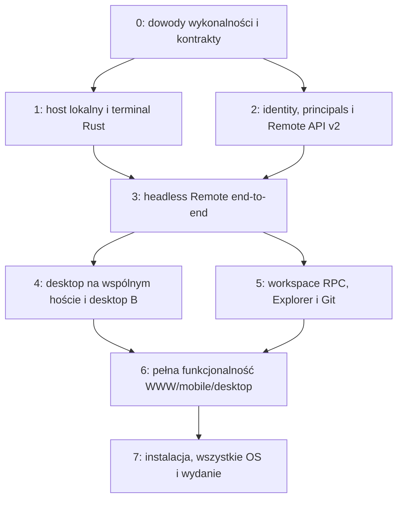

# 07 — Etapy realizacji, testy i kryteria odbioru

## Co oznacza „gotowe”

Gotowe v1 oznacza zarówno natywny serwer z TUI, jak i działające cztery aplikacje według wspólnego kontraktu. Sam daemon z istniejącym terminalowym WWW jest demonstratorem, nie końcem zadania. Explorer, Source Control, nowe terminale i desktop B są elementami obowiązkowymi pierwszego kompletnego wydania.

Wynikiem obecnej fazy jest wyłącznie dokumentacja. Poniżej są zadania i plan przyszłej walidacji, a nie raport testów wykonanych teraz.

## Kolejność i zależności

Adaptery usług i instalator budujemy wcześnie jako harness testowy w etapach 0–1; etap 7 kończy ich kwalifikację, podpisy i publikację. TUI nie czeka do końca, ale jego finalne dopracowanie następuje na stabilnym local API. Etapy można wykonywać częściowo równolegle dopiero po ustaleniu kontraktów.

## Etap 0 — wykonalność, decyzje i release provenance

Zadania:

- **S0.1 Terminal Rust:** porównać pełny model `alacritty_terminal` i `vt100`, zaimplementować próbny snapshot + restore adapter do aktualnego xterm Lomi. Odtworzyć ekran i kontynuować strumień po wielu godzinach, resize i utracie bounded replay. Sprawdzić odpowiedzi DSR/DA bez duplikatów. Nie używać Node w produkcyjnym harness hosta.
- **S0.2 Windows/Linux boot:** zbudować najmniejszy PTY host uruchamiany w systemd user + linger oraz rzeczywistej usłudze SCM. Zweryfikować spawn/resize/Ctrl-C/exit/process tree, IPC, secret storage, restart i brak login session. Dołożyć macOS LaunchAgent/Daemon i locked-storage test.
- **S0.3 Desktop domain:** zaprojektować i przetestować mapping mixed layout ↔ terminal projection, move/close między widokami, eventy w dwóch oknach i ochronę private dirty editorów. Określić granicę zwykłych vs protected agent terminals.
- **S0.3a Git read isolation:** zweryfikować wykonalność przeniesienia macOS read-only executor na Linux/Windows: bez fork/exec configured helpers, sieci i odczytu prywatnych danych spoza repo/runtime. Filtry Git są uwzględnione, nie tylko hooks/diff. Określić fail-closed obsługę niewspieranej konfiguracji.
- **S0.4 Auth:** potwierdzić device authorization w istniejącym Better Auth 1.7.6/lockfile, jednokrotną wymianę na host authorization, lifetime/rotation/revoke i model desktop consumer FK.
- W S0.3 objąć próbą także IPC admission lokalnego native taska kontra remote file/Git write i shell/CWD bez renderera. W S0.4 dowieść immutable enrollment/key/bootstrap-session binding, proof-of-possession i recovery utraconego exchange/refresh.
- **S0.5 Kontrakt:** zamrozić API major 2, grant/context v3, capability set, dynamic membership, limits, errors i profile negocjacji. Wygenerować pierwsze schemas/fixtures i manifest wersji.
- **S0.6 Release:** wyznaczyć canonical Remote Web, crypto i shared client; przygotować CI source digests. Wybrać signing/TUF bootstrap i sprawdzić instalację bez Cargo/Node.
- S0.5 obejmuje także dwa okna jednego web consumer authorization oraz test obciążenia globalnego authorization locka przy zwiększonym budżecie kanałów; freshness i revoke muszą zmieścić się w budżecie razem z kolejkami locka.

Deliverable: krótkie raporty prób, wyniki/artefakty dla OS, zaakceptowane decyzje i brak krytycznej niewiadomej uniemożliwiającej Rust-only terminal. Jeśli snapshot lub Windows service nie przejdzie próby, zmieniamy projekt i estymację przed szeroką przebudową. To świadome bramki, nie obietnica usunięcia problemów przez podniesienie limitów.

Każdy spike ma właściciela technicznego, zapisany zestaw wersji, powtarzalną komendę/harness, fixture, obserwowany wynik i decyzję pass/fail. Brak dostępu do platformy oznacza `not run`, nigdy `passed`. Szablon dowodów, checkpointów i rejestru decyzji jest w [10](10-operacje-i-weryfikacja.md).

## Etap 1 — lokalny host i podstawowe TUI

Zadania:

- Cargo workspace, profile, owner lock, native IPC, handshake i minimalny `doctor`.
- SQLite schema projekt/workspace/tab/pane/profile/receipt/outbox, transakcje i backup.
- PTY service, jeden Rust model na sesję, atomic snapshot+subscribe, ACK/resync/lease/resize.
- Command API tworzenia, rename, split, move, close/restart; bez zależności od GUI.
- CLI i Ratatui: setup draft, workspace list/add, status, service/manual start/stop, poprawne wyjście z TUI.
- Adaptery macOS/Linux/Windows z harness service install i stop; granice secret storage.

Odbiór: dwa lokalne klienty obserwują ten sam terminal, jedno pisze, wyjście z TUI/rozłączenie nie zabija sesji. Drugi daemon nie startuje na tym samym profilu. Po restarcie właściciela UI widzi utratę sesji i nową epokę zamiast fikcyjnego wznowienia procesu. Binarium hosta nie ładuje Tauri/Node/GUI.

## Etap 2 — platforma kont i autoryzacja

Zadania:

- Host enrollment i osobne credentials z rotacją/idle expiry/recovery; account UI revoke.
- Consumer authorization web/mobile/desktop, SQL FK/checks/immutable ownership, least-privilege roles.
- Remote API v2: host registration, heartbeat/publication acknowledgment, inventory, pairing, signed grants v3, channels/tickets/revoke.
- Relay admission nowego kontekstu i pomiar freshness; brak publicznych identity/authority endpoints.
- Feature gates per nowy protokół/platforma; komunikaty update/offline/service unavailable.
- Global revoke/maintenance/account-delete i regresja push class checks; trwały local fence po offline logout. Test reactivation konta nie przywraca starego host refresh tokena.

Odbiór: desktop konsument nie może wykonywać operacji hosta bez host authorization i odwrotnie. Zmiana dowolnego podpisanego capability/epoch/peer unieważnia grant. Revoke/logout/refresh reuse działa transakcyjnie przy wyścigach. Testy uruchamiają rzeczywistą PostgreSQL z ograniczonymi rolami, nie tylko mock Prisma.

## Etap 3 — headless Remote od instalacji do zdalnego terminala

Zadania:

- Remote service hosta: device login, publish/outbox, pairing, Noise, workspace/terminal channels, backoff i fencing.
- Klient referencyjny nowego kontraktu w Remote Web: katalog → metadane → shell → reconnect.
- Zgodność crypto między Rust native, WASM i mobile native z tym samym manifestem.
- Kreator w TUI z pierwszym workspace’em i sharing consent; działająca usługa na VPS bez GUI.

Odbiór: nowa maszyna Linux → testowy instalator → kod w telefonie → udostępniony workspace → rzeczywisty shell z przeglądarki. Po zamknięciu SSH/TUI terminal pracuje. Utrata sieci nie powtarza input. Unshare blokuje już odebrane, jeszcze niewykonane mutacje/input. Ten milestone nie jest jeszcze pełnym wydaniem produktu.

## Etap 4 — desktop A/B i jedna domena

Zadania:

- Desktop zaczyna korzystać ze wspólnego hosta dla zwykłych terminali i Share remotely.
- Root/project/workspace import, stable IDs, local/private views i revision-based commands.
- Desktop remote connection adapter i remote workspace selector na B.
- Nowe terminal tabs/splits/windows, stan we wszystkich oknach i lease dla resize/input.
- Close/update/logout behavior odłączony od przypadkowego shutdown hosta; protected AI terminal exclusion.

Odbiór: ten sam workspace udostępniony w TUI i desktopie ma identyczny host/workspace ID i politykę. Nowa karta na B pojawia się na A i WWW; nowe okno B nie tworzy shella. Zamknięcie GUI A nie odcina Remote. Mixed layout zachowuje nieudostępnione edytory/browser/Android i niezapisane bufory przy zdalnym close/move.

## Etap 5 — Explorer, Git i operacje workspace’u

Zadania:

- File service: root-relative reads/mutations/watch, symlink/reparse protection, encoding i opaque path IDs.
- Git service: parsowalne output, izolowany read-only executor wszystkich platform, wspólny repo guard, HEAD/index preconditions, polityka executable config/hooks/filters i credentials required.
- Workspace RPC streams, event invalidation, cancellation, durable operations i status po reconnect.
- Interfejsy desktop/WWW: lista/podgląd pliku, file actions, status/diff/history, stage/commit/network actions.

Odbiór: zmiany w plikach na A natychmiast unieważniają widok B; rename/delete na B mają wynik i konflikt przy zmianie równoczesnej. Status/diff zgadza się z Git hosta, commit/push nie powtarza się po utracie odpowiedzi. Brak Git/credentials nie psuje terminala. Inny workspace tego samego repo nie omija blokad. Shellowe prawa OS są jasno odróżnione od granicy file API.

## Etap 6 — pełna spójność klientów

Zadania:

- Wspólna paczka kontraktów/maszyna stanów, adaptery dla desktop/Worker/native crypto.
- Explorer, Git i terminal management w mobile; dopasowanie nawigacji i jednej aktywnej sesji.
- Równoważne błędy, capabilities, revoke, retry i privacy lifecycle w trzech klientach.
- Generowanie i kontrola snapshot renderer/provenance; testy wszystkich artefaktów.
- Usunięcie kopii WWW i ręcznych kopii protokołu z aktywnych źródeł.

Odbiór: każda komenda v1 ma test z desktopu, web i mobile. Jawny brak opcjonalnej capability może mieć czytelny stan UI; brak obowiązkowego Explorer/Git/terminal management blokuje deklarację kompletnego v1 na danym wspieranym kliencie/hoście. Różnica „jeden pane na telefonie” nie zmienia shared layout. Browser refresh i mobile foreground odzyskują widok bez replay mutacji/input. Dwa okna pod jednym cookie pozostają podłączone również po refreshu jednego. Wszystkie release artifacts zgadzają się z manifestem źródeł.

## Etap 7 — wydanie wieloplatformowe i cutover

Zadania:

- Instalatory sh/ps1, podpisy, notary/Authenticode, signed metadata i odtwarzalny pipeline release.
- Autostart wszystkich deklarowanych trybów, aktualizacja/rollback/uninstall i redacted diagnostics.
- End-to-end qualification na prawdziwych OS/VM bez sesji graficznej, soak i chaos.
- Zamknięcie najważniejszych findings niezależnego przeglądu bezpieczeństwa, runbook revoke/key rotation/restore.
- Skoordynowany cutover API/relay/WWW/host/desktop/mobile, ponowna zgoda sharing i usunięcie starego runtime Node.

Odbiór: czysta maszyna bez środowiska deweloperskiego realizuje pełny scenariusz użytkownika; checksum/signature tampering blokuje instalację; błędna aktualizacja nie niszczy konfiguracji. Stare klienty mają jasny update path. Dostępność i feature gates zgadzają się z rzeczywistymi wynikami platform, nie samym udanym cross-compile.

## Platformy i macierz kwalifikacji

Docelowa propozycja wsparcia v1, do zatwierdzenia po spikach:

| Host | Architektura | Co trzeba sprawdzić |
| --- | --- | --- |
| Linux: Ubuntu 22.04+/Debian 12+ jako bazowe środowiska | x86_64, aarch64 | glibc ABI dla paczek, SSH bez GUI, systemd user/linger, dedicated user, brak keyring |
| macOS 14+ | Apple silicon i Intel | LaunchAgent, LaunchDaemon, locked keychain/FileVault, podpisy/notarization |
| Windows 11 | x64, ARM64 | Logon task, SCM dedicated account/session 0, ConPTY, DPAPI, ACL i aktualizacja EXE |
| Windows Server 2022+ | x64 | Unattended SCM i PowerShell bez interaktywnego desktopu; również wariant Server Core w próbach |

Musl/Alpine, BSD, starszy Windows i inne init systems nie są cicho reklamowane jako wspierane przez sam napis „Rust”. Mogą używać przyszłych targetów lub foreground po osobnej kwalifikacji. Brak wsparcia jednego targetu musi być widoczny w stronie instalacji, release manifest i feature flags.

Klienty: desktop na wspieranych OS; Chromium/Firefox/WebKit w WWW; Android i iOS w mobile. Sprawdzić realną klawiaturę/IME i background lifecycle przynajmniej na jednym urządzeniu fizycznym na platformę mobilną, nie tylko simulator.

## Testy o najwyższej wartości

| Obszar | Obowiązkowe przypadki |
| --- | --- |
| Tożsamości | Host vs consumer class confusion, obce konto, źle powiązany FK, replay enrollment, refresh race/crash/reuse, logout/revoke |
| Kryptografia | Native↔WASM↔mobile, zmienione capabilities/epoch/purpose, pin replacement, downgrade, złe długości, replay/order, dispose/rekey |
| Terminal | Output przed attach, parser partial state, alternate screen, Unicode, mouse/paste, resize, 2+ observers, slow client, queue overflow, ordered exit |
| Input | Focus/lease, local takeover, stale lease, partial write receipt, 401 podczas kolejki, brak replay po reconnect; observe-only attach po reboocie nie uruchamia shella |
| Domena | Empty workspace, create/close/move w dwóch klientach, CAS conflict, publication opóźnione/odwrócone, stale events, unshare podczas create |
| Pliki | `..`, absolute paths, symlink/junction race, non-UTF-8, Windows case/ADS, FIFO/device, duże/binarne pliki, rename collision, concurrent external write |
| Git | Spacje/newline w nazwach, HEAD/index race, dwa workspace’y jednego repo, external diff/hooks/helpers/clean-process-smudge filters, podmienione attributes/config i podmieniony kod helpera przy stałej konfiguracji, transitive helpers/aliasy poza root, brak git.execute nie wykonuje repo code, brak odczytu poza root i sieci w read-only, missing identity, brak credentials, ff-only conflict, uncertain push |
| Usługa | Boot bez loginu, logout OS, uprawnienia IPC innego UID/SID, drugi owner, cloned profile na drugiej maszynie, runtime lease loss/takeover, stale socket, locked storage, full disk, uszkodzona baza |
| Update | Zły podpis/hash, downgrade/freeze, interrupted download, EXE locked, migracja/rollback, brak sieci przy revoke/uninstall |
| Interfejsy | Dirty private editor przy remote close, close view vs close PTY, popup blocking, mobile background/rotation, wersje profile i clear plaintext po revoke |
| Integracja lokalna | Native task/MCP kontra daemon file/Git write, utrata IPC writera, OSC 7/CWD przy zamkniętym GUI, brak renderera nie zatrzymuje PTY |
| Sesje i skala | Dwa browser keys pod jednym cookie, refresh jednego okna, revoke key vs parent session, account reactivation, push principal regression, authority lock queue przy pełnym budżecie |

Wykorzystać istniejące testy `remote-live`, relay runtime/admission, crypto/workspace fixtures, session ownership i snapshot tests jako specyfikację niezmienników. Nie kopiować testów starego wire format jako wymagania kompatybilności nowego. Testy crash/races wymagają prawdziwych procesów, SQLite/PostgreSQL i ograniczonych ról; mock transport nie wystarcza do potwierdzenia reboot survival lub revocation.

## Cele niefunkcjonalne do pomiaru

Wartości startowe, nie wyniki pomiarów:

- Idle host bez PTY: średnio <1% jednego rdzenia i <64 MiB RSS na wybranej maszynie referencyjnej; bez spin loop i intensywnego pollingu GUI.
- Po zestawieniu połączenia, przy RTT 100 ms i lekkim shellu, p95 key-to-visible-echo ≤250 ms. Osobno mierzyć sieć, host dispatch i render; czasu kompilacji nie zaliczać do opóźnienia transportu.
- Snapshot wyświetlony do 2 s dla typowego skonfigurowanego terminala/łącza; duży scrollback chunkowany i ograniczony, bez blokowania odczytu PTY.
- Local unshare: fence przed powrotem sukcesu; centralny revoke/lost freshness: cel ≤5 s do zablokowania writerów. Każdy próg ma test pod obciążeniem i przy timeout authority.
- Soak 24 h w etapie integracji i 72 h przed wydaniem: retained PTY, okresowy reconnect, rotacja credentials, 2–8 klientów i próby wolnego odbiorcy. Brak nieograniczonego wzrostu RAM, kanałów, descriptors i watchers.
- Limity zasobów muszą dawać jawny błąd przy odmowie, zachowując działające sesje. Liczba 32 terminali nie oznacza, że host gwarantuje zasoby dla dowolnych 32 ciężkich aplikacji potomnych.

## Scenariusze końcowego odbioru produktu

1. **VPS:** na czystym Linux użytkownik instaluje jednym poleceniem, wybiera boot mode, loguje host kodem na telefonie, zakłada workspace. Po zamknięciu SSH i reboot host wraca online bez GUI; uprawnione `terminal.restart` tworzy świeży shell, nie kontynuację dawnego procesu. Obserwator widzi utraconą/zatrzymaną sesję i nie uruchamia jej przez samo otwarcie widoku.
2. **Desktop A → desktop B:** Share remotely na A → konto na B → ten sam workspace, terminale, Explorer i Source Control. Nowa karta/split z B widoczna na A; nowe okno B nie dubluje shelli. Wyjście GUI A nie wyłącza hosta.
3. **Web i mobile:** równoczesne otwarcie tego workspace’u, snapshot i output, kontrolowane takeover/resize, podgląd pliku/diffu i create terminal. Mobile background nie wysyła starych klawiszy po powrocie.
4. **Terminal-only:** browser/Android/chat/editor na A nie pojawiają się jako udostępnione panele na B. Zdalny close terminala z mixed view zachowuje lokalny dirty editor.
5. **Revocation i utrata odpowiedzi:** unshare podczas input/create/commit, centralny revoke, awaria relay/identity i opóźnione publish. Brak przyszłych nieautoryzowanych efektów; niepewne rozpoczęte efekty są pokazane jako uncertain, bez replay.
6. **Aktualizacja:** błędny podpis blokuje upgrade; poprawny upgrade uprzedza o zakończeniu aktywnych sesji, zachowuje katalogi i politykę, a recovery nie uruchamia starego binarium na nowym schema.

## Szacunek nakładu

To estymacja projektowa po analizie kodu, nie zobowiązanie terminowe. Nie wykonano jeszcze spików. Największe zmienne to terminal fidelity, desktop mixed layout, Windows service/ConPTY oraz credential lifecycle.

| Pakiet | Orientacyjny nakład |
| --- | --- |
| Spiki i kontrakty | 2–4 osobotygodnie |
| Rust host, terminal, persistence, IPC i TUI | 7–11 osobotygodni |
| Identity, API/DB/relay, crypto contract | 4–7 osobotygodni |
| Desktop extraction + desktop consumer | 5–9 osobotygodni |
| File/Git service + klienty i parity | 6–10 osobotygodni |
| Packaging, platform qualification, hardening i cutover | 5–9 osobotygodni |

Łącznie około **29–50 osobotygodni** pracy inżynierskiej, z częściowym nakładaniem się etapów i rezerwą na wyniki spików. Dla jednej osoby to projekt wielomiesięczny; dla 2–3 doświadczonych osób rozsądny wstępny horyzont to około 4–7 miesięcy, zależny od kwalifikacji i recenzji. Nie sumować równoległych zadań jako pewnego kalendarza. Po etapie 0 przeliczyć estymację na podstawie wyników i ustalić release gates.

Wcześniejszy demonstrator Linux host + terminal web można uzyskać wcześniej, ale nie zastępuje pełnego zakresu wskazanego przez użytkownika. Jeśli trzeba ograniczać zakres, jawnie negocjować wydanie, zamiast ukrywać brak Explorer/Git/desktop B pod nazwą „MVP”.

## Rejestr ryzyk

| Ryzyko | Skutek | Działanie ograniczające |
| --- | --- | --- |
| Rust snapshot nie zachowuje semantyki xterm | Uszkodzony reconnect lub input interaktywnych CLI | Bramka S0.1, differential tests, brak ukrytego Node fallback |
| Dwie domeny desktop/daemon | Rozjechane karty, utrata prywatnych widoków | Jedyny autorytet terminali, revision, mixed-view spike i tests |
| ConPTY/sekrety działają tylko po loginie | Fałszywa obietnica serwera Windows | Test rzeczywistej SCM usługi bez zalogowanego użytkownika |
| Zakres starych grantów rośnie automatycznie | Nieautoryzowany dostęp do plików/Git | Nowy grant/context, ponowna zgoda i capabilities |
| Layout revision unieważnia wszystkie kanały | Uciążliwe odłączanie przy create/rename | Rozdzielenie domain revision i grant revision |
| Kopie WWW/crypto/protokołu rozchodzą się | Wydanie niespójnego zestawu | Canonical source, immutable artifacts i provenance gate |
| Retry niepewnej operacji | Podwójne komendy, commit/push lub delete | Receipts, outcome unknown i read/reconcile |
| Headless storage nie działa po boot | Host offline lub plaintext fallback | Jawny backend, fail-closed, reboot tests |
| Aktualizacja kończy procesy użytkownika | Utrata zadań | Ręczny moment instalacji i jawne zakończenie sesji |
| Relay single-owner bez runbook | Niedostępność podczas deployment | Cutover zgodny z lease; multi-relay jako osobny przyszły projekt |

## Decyzje pozostawione do zamknięcia w etapie 0

Nie wymagają odpowiedzi użytkownika, żeby ten plan był użyteczny; mają właściciela i sposób rozstrzygnięcia:

1. Konkretny Rust terminal engine i dokładny snapshot profile — wynik prób zgodności, nie preferencja estetyczna.
2. Dokładny zestaw wspieranych OS/arch i dystrybucji binariów — wynik rzeczywistych boot/PTY/ABI prób.
3. Lifetime credentials/retencja/budżety — testy auth, obciążenie i polityka konta; proponowane wartości zapisano w planie.
4. Mechanizm TUF/bootstrap i operatorzy kluczy wydania — spike instalacji/rollback i runbook rotacji.
5. Dokładny mapping mixed layout przy zdalnym move/close — próba z istniejącym docking i dirty views.

Założenia produktu przyjęte w tym planie: Rust-only host, Ratatui, jeden Remote dla desktop/CLI, własne konto, Explorer/Git w v1, terminal-only shareable panels, brak gwarancji żywego PTY po restarcie i brak kompatybilności starego Remote. Ich zapis nie jest potwierdzeniem wdrożenia ani osobną zgodą użytkownika na publikację. Wymagania `REQ-*` i granice są w [00](00-cel-i-wymagania.md).
